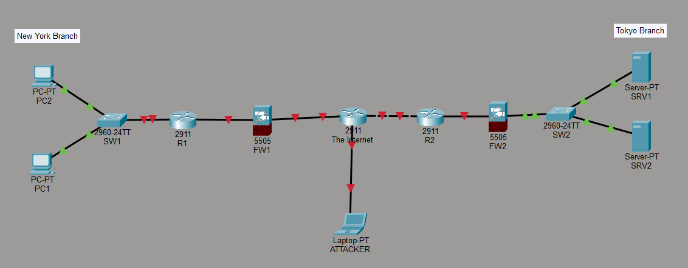

# Lab 01 — Packet Tracer introduction

[← All labs](../README.md) · [Download lab](./lab_file.pkt)

## Objective

Practise the Packet Tracer interface by placing, naming, and connecting devices in a simple two-branch topology.

**Scope: topology construction and device identification. End-to-end IP connectivity and firewall protection have not been demonstrated in this documentation.**

## Files

| File | Purpose|
| :--- | :--- |
| [lab_file.pkt](./lab_file.pkt) | Packet Tracer workspace|
| [topology.png](./topology.png) | Saved topology preview|
| README.md | Instructions and review checklist|

The Packet Tracer version used to save the workspace has not been recorded. Record your version when opening or reporting an issue.

## Topology and device roles

| Location| Devices| Role|
| :--- | :--- | :--- |
| New York | PC1, PC2; 2960-24TT SW1; 2911 R1; ASA 5505 FW1 | User devices, local switching, routing, firewall position|
| Transit | 2911 named “The Internet” | Simplified transit router|
| Tokyo | SRV1, SRV2; 2960-24TT SW2; 2911 R2; ASA 5505 FW2 | Servers, local switching, routing, firewall position|
| External segment | Laptop named ATTACKER | External-host placeholder|

The inventory in the preview is 3 routers, 2 switches, 2 firewalls, 2 PCs, 2 servers, and 1 laptop.

“The Internet” is a label for a single simulated router, not a real Internet connection or a complete ISP network. The ATTACKER label alone does not simulate an attack.

## Topology preview



**The saved preview contains several red link indicators. It illustrates device placement and cabling, not a fully operational network.**

A green indicator does not prove end-to-end IP reachability. A red indicator requires checking the connected interfaces, cable, power, and administrative state; it does not identify the cause by itself.

## Connections to inspect

These are device-to-device connections visible in the preview. Exact port numbers and cable types must be inspected in the workspace; they are not readable in this screenshot.

| Segment| Device path|
| :--- | :--- |
| New York endpoints| PC1 ↔ SW1; PC2 ↔ SW1 |
| New York uplink| SW1 ↔ R1 ↔ FW1 ↔ The Internet |
| Tokyo uplink| The Internet ↔ R2 ↔ FW2 ↔ SW2 |
| Tokyo endpoints| SW2 ↔ SRV1; SW2 ↔ SRV2 |
| External host| ATTACKER ↔ The Internet |

FW1 is outside R1 toward the transit segment; FW2 is inside R2 toward the server LAN. These placements illustrate two possible positions. Security depends on configuration and the traffic path.

## Reproduce and inspect the lab

1. Download and open `lab_file.pkt`. Save a separate copy before experimenting.

2. Find the router, switch, firewall, PC, server, and laptop categories. Compare the models and device labels with the inventory.

3. Inspect each cable endpoint in Packet Tracer. Record both interface names and the cable type before deciding whether to change it.

4. Check that all devices are powered on. Allow time for link initialization, then inspect any red links.

5. On IOS routers, use the read-only commands below to inspect interfaces.

```text
enable
show ip interface brief
show interfaces
```

If an interface reports `administratively down`, it is administratively disabled. Enabling the intended interface with `no shutdown` may be needed in a configuration exercise, but that alone does not configure addressing, routing, or firewall policy.

ASA 5505 uses switch ports and VLAN interfaces. Do not assume it is configured exactly like a 2911 router.

## Learning checks

- **Why use SW1 and SW2?** To connect local endpoints.

- **Why use R1 and R2?** To route between different networks once configured.

- **Does placing FW1 and FW2 prove security?** No; interfaces and security policies must be configured and tested.

- **What is the intended PC1-to-SRV1 path?** PC1 → SW1 → R1 → FW1 → transit router → R2 → FW2 → SW2 → SRV1.

## Review checklist

- [ ] Identify every device and explain its role.

- [ ] Compare workspace labels and connections with the saved preview.

- [ ] Record connected interfaces and cable types from Packet Tracer.

- [ ] Explain any red links using interface evidence rather than guessing.

- [ ] Distinguish physical link status from IP reachability and security enforcement.

These are learner checks, not completed or automated test results. The binary workspace has not been executed as part of this documentation review.

## Further configuration

To turn this into a working connectivity lab, add an addressing plan, interface configuration, routing, ASA VLAN/interface and security settings, and recorded tests for allowed and denied traffic. Those tasks are beyond this introductory lab.

## References

- [Cisco IOS interface inspection](https://www.cisco.com/E-Learning/bulk/public/tac/cim/cib/using_cisco_ios_software/cmdrefs/show_ip_interface.htm)
- [Cisco ASA 5505 ports and VLAN interfaces](https://www.cisco.com/c/en/us/td/docs/security/asa/asa92/configuration/general/asa-general-cli/interface-basic-5505.html)
